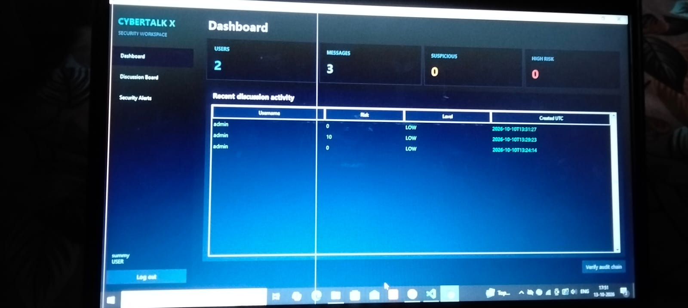
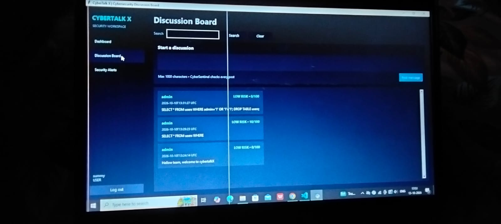
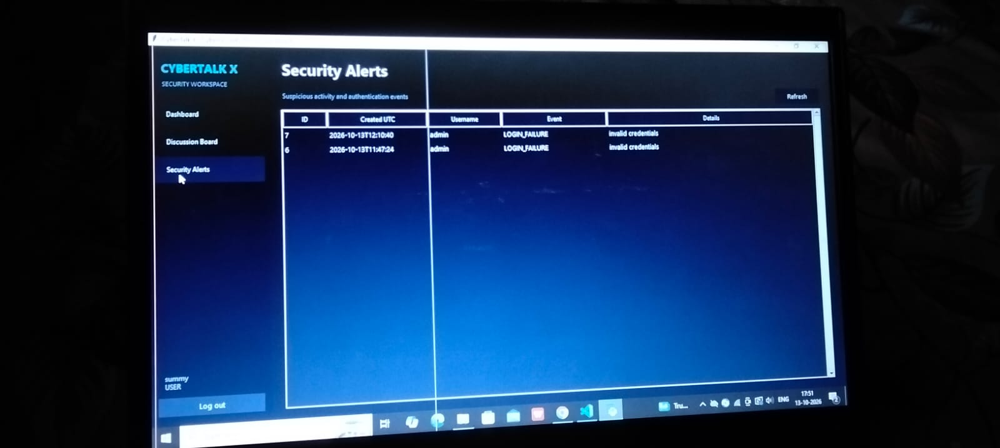
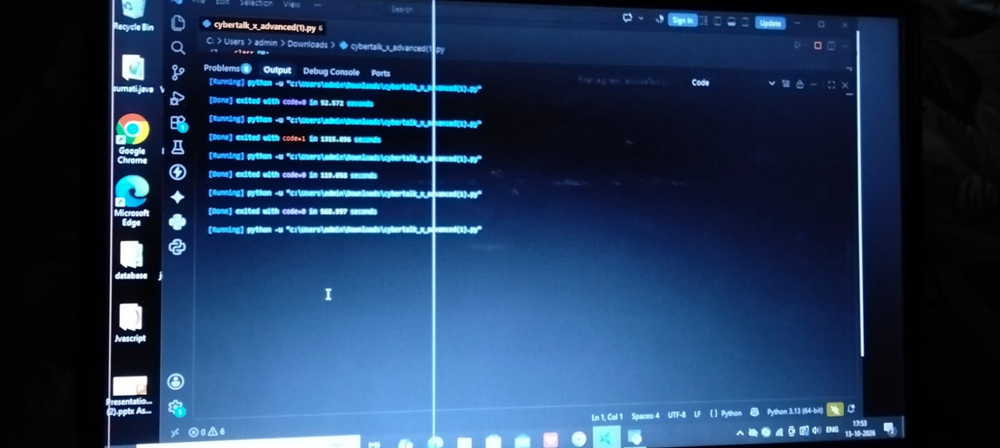

# CyberTalk X

### A Python-Based Cybersecurity Discussion Board with Explainable Suspicious-Activity Detection

## About the Project

CyberTalk X is a Python-based desktop application developed as a college project. It provides a platform where users can create accounts, log in, publish messages, and review security-related activities.

The project demonstrates basic cybersecurity concepts using Python, Tkinter, and SQLite. It also includes a rule-based system that identifies potentially suspicious activity and explains why a message has been flagged.

## Features

* User Registration and Login
* Password Hashing for Account Security
* Discussion Board for Posting Messages
* Search Previous Posts
* Rule-Based Suspicious-Activity Detection
* Security Alerts and Event Review
* Hash-Linked Audit Log
* Audit Log Verification

## Technologies Used

* **Programming Language:** Python
* **GUI:** Tkinter
* **Database:** SQLite
* **Security:** PBKDF2 Password Hashing and SHA-256 Audit Hashing

## How Suspicious Activity Detection Works

The application checks messages for configured patterns such as repeated messages, rapid posting, multiple links, URL shorteners, excessive uppercase letters, and repeated characters.

It assigns a risk score and displays a risk level such as LOW, MEDIUM, or HIGH.

**Note:** These alerts are rule-based indicators. They do not prove that a user is malicious.

## How to Run the Project

1. Install Python 3.10 or later.
2. Download or clone this repository.
3. Open the project folder in Visual Studio Code.
4. Run the main Python file.
5. Register a new account or log in to use the application.

The exact Python filename may vary depending on the project files.

## Project Purpose

The main purpose of CyberTalk X is to understand how Python can be used to build a desktop application with user authentication, database operations, basic cybersecurity monitoring, and audit-log verification.

## Limitations

* This is an educational prototype.
* Suspicious-activity detection uses predefined rules.
* The application is not a replacement for a production security monitoring system.

## Future Scope

* Improve suspicious-activity detection.
* Add more security monitoring features.
* Improve the user interface.
* Add stronger deployment and database protection

  ## Screensshots

  ![Login Screen] (1.jpeg)
  
  
  
  

## License

This project is intended for educational and learning purposes.        

